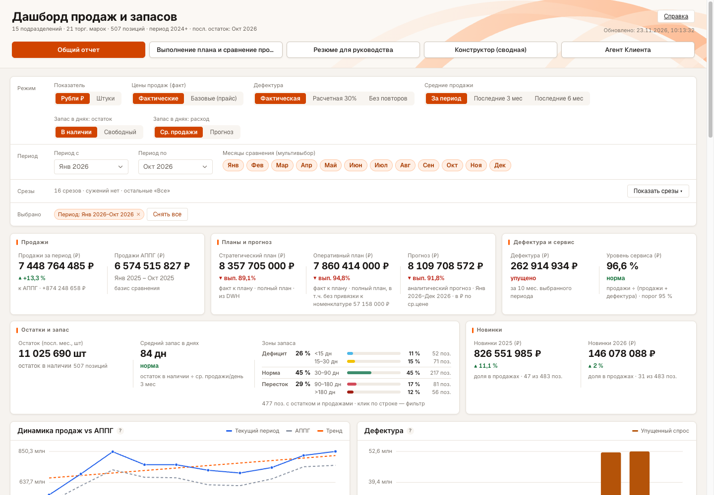
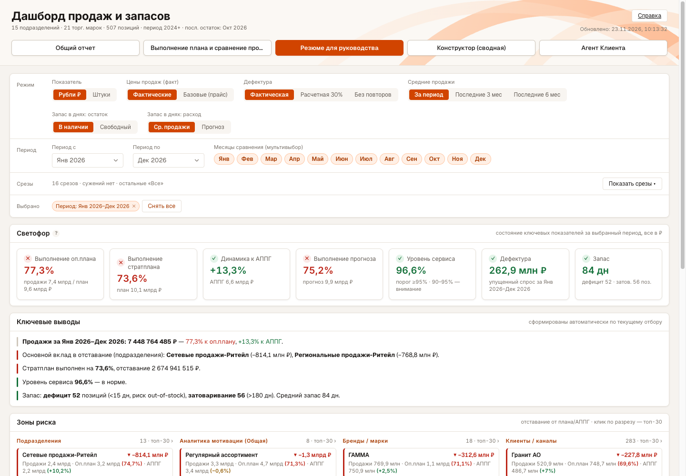
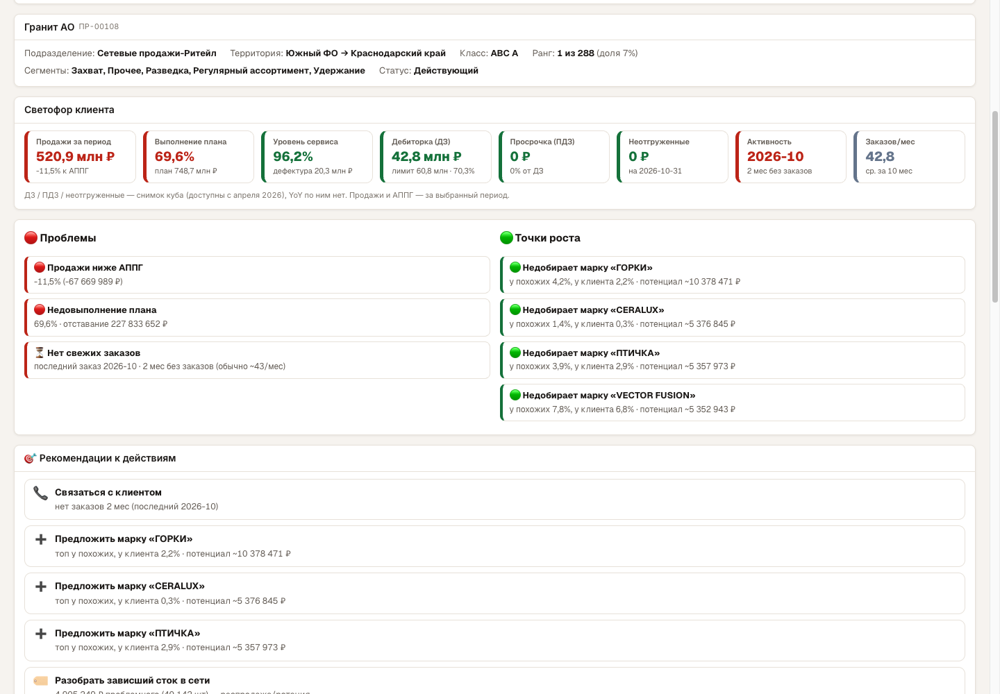

# Sales Performance Dashboard

[](https://github.com/MaxWell-com/sales-performance-dashboard/actions/workflows/ci.yml)


**One-page sales cockpit for a manufacturer.** It shows sales against the same period last year, plan against actual, unfulfilled demand, stock cover, an auto-written executive summary and a per-client "agent". The whole page cross-filters instantly in the browser.

> This is a production project, adapted for public release. In production it served the commercial team of a consumer-goods manufacturer as an internal web app. It pulled ~1.3M sales rows live from an OLAP cube (SSAS Tabular over XMLA) and a DWH. The public version ships with a deterministic **demo data source** that has the same shape, so it runs with zero infrastructure: `npm start`. All companies, clients, brands and people are fictional. The UI is in Russian, as in production.

<p align="center"></p>

## What it shows

| Tab | What the user gets |
|---|---|
| **Общий отчет** (overview) | Sales and YoY. Unfulfilled demand: actual, de-duplicated, and estimated at 30%. Service level. Operating plan, strategic plan and analytical forecast. Stock and days of cover by zone (<15 / 15–30 / 30–90 / 90–180 / >180 days). ABC classes, new launches, monthly dynamics. Hierarchical drill-down tables by product (direction → group → brand → line) and by client (department → territory → manager). |
| **Выполнение плана** (plan vs actual) | Plan attainment by department and by sales-motivation line, with month-by-month comparison |
| **Резюме для руководства** (executive summary) | Traffic-light KPIs, **auto-generated conclusions**, risk and growth zones by department, line, brand and client, top-30 lists with Excel export |
| **Конструктор** (pivot builder) | A pivot table on any dimensions, built in the browser and exported to `.xlsx` with no server round-trip |
| **Агент Клиента** (client agent) | A one-client deep dive: sales, plan, service level, receivables and overdue, open orders, activity. **Rule-based problems, growth points and next-best actions** (e.g. "under-buys brand X compared with similar clients, potential ~₽10M"), purchase structure against peers, stock at the client |

Associative filtering runs across **16 dimensions**: picking a value in one narrows the options in all the others. Every card explains its methodology behind a «?» tooltip.

<p align="center"></p>

## Engineering decisions

**Snapshot instead of query-per-click.** The dashboard cross-filters over a million sales rows and computes ABC, new launches and plan allocation on the client. A live DAX query on every click would mean seconds of waiting per click and rewriting all the proven logic. Instead the server builds an in-memory **snapshot** once and embeds it into the page as compact JSON. After that, every interaction is instant.

* **Compact transport from the cube.** The XMLA responses are verbose, so the fact table is fetched month by month, by surrogate keys with one-letter aliases (`SELECTCOLUMNS`). Names are joined later from small dictionaries. Everything is encoded as integer registries and tuples.
* **Never block the user.** The snapshot is built in about a minute in production, which is longer than the auth proxy's timeout. So the server builds it when it starts and shows a self-refreshing "report is being built" page in the meantime. After that it serves a stale snapshot while it rebuilds in the background (stale-while-revalidate, 6 h TTL by default).
* **One snapshot contract, two sources.** `src/dataSource.js` selects `DATA_SOURCE=demo` (default) or `DATA_SOURCE=olap`. Both sources feed the same assembler (`src/report/snapshotCore.js`), so they cannot drift apart in shape, and tests check that the demo shape matches the original key by key. The OLAP path uses a dependency-free XMLA-over-HTTP client and an optional DWH client (MS SQL), both configured only through environment variables.
* **No front-end build.** One HTML template with vanilla JS, SVG charts, its own `.xlsx` writer, and fonts embedded in the page (the production network had no outbound internet).
* **Graceful degradation.** If an optional source fails (DWH, forecast, strategic plan), only its block is empty and the reason is shown. Everything else keeps working.

<p align="center"></p>

## Demo data

[`src/demo/`](src/demo) generates a deterministic business with a seeded random generator and no dependencies. It runs from January 2024 to October 2026 and has:
- ~500 SKUs across 21 brands of a fictional manufacturer, **NORD**;
- ~300 clients in 15 departments and 35 territories, with regional and territorial managers;
- monthly sales with seasonality, trend, launches and phase-outs;
- unfulfilled demand with spikes;
- stock spread across every cover zone;
- production, an operating plan, a strategic plan, a forecast, base prices, receivables and stock at the client.

It builds in under half a second into a ~8 MB snapshot.

## Quickstart

```bash
git clone https://github.com/MaxWell-com/sales-performance-dashboard.git
cd sales-performance-dashboard
npm install
npm start            # http://localhost:3000 — demo data, no configuration
npm test             # snapshot contract + server smoke tests (node:test)
```

With Docker: `docker build -t sales-dashboard . && docker run -p 3000:3000 sales-dashboard`.

To connect real sources, set `DATA_SOURCE=olap` and the `OLAP_*` / `DWH_*` variables from [`.env.example`](.env.example). Access control is optional. Behind a reverse proxy such as oauth2-proxy, the user comes from the `X-Auth-Request-*` headers, and `REQUIRED_TEAM` restricts the page to the listed groups.

## Repository structure

```
src/
├── server.js, app.js        # Express app: prewarm, background refresh, routes, /health
├── dataSource.js            # demo | olap switch (lazy-loaded)
├── auth.js                  # optional identity from reverse-proxy headers, group check
├── view.js                  # report page, "building" page, error page, user guide
├── sources/                 # demo.js, olap.js — same three capabilities each
├── demo/                    # deterministic synthetic business (catalog, model, client agent, client stock)
├── report/
│   ├── snapshotCore.js      # the snapshot contract: registries, tuples, motivation hierarchy
│   ├── olapSnapshot.js      # production build from the cube + DWH
│   ├── snapshot.js          # cache with stale-while-revalidate
│   ├── dashboard.template.html   # the whole dashboard: layout, charts, filters, pivot, xlsx export
│   └── guide.html           # user guide (in Russian)
├── profiles/                # client-agent API
├── olapClient.js            # XMLA over HTTP, no native dependencies
└── dwhClient.js             # optional MS SQL source
test/                        # node:test — snapshot invariants, server smoke test
```

**Stack:** Node.js · Express · vanilla JS · SVG · DAX / SSAS Tabular (XMLA) · MS SQL · Docker · GitHub Actions

---

## Кратко на русском

**Дашборд продаж и запасов для производителя.** Это рабочий проект, адаптированный для публикации. В нём вкладки:
- общий отчёт: продажи к АППГ, дефектура и уровень сервиса, операционный и стратегический план, прогноз, запас в днях по зонам, ABC, новинки;
- план-факт;
- резюме для руководства с автоматическими выводами и зонами риска;
- конструктор сводных с выгрузкой в Excel;
- «Агент Клиента»: проблемы, точки роста и рекомендации по одному клиенту.

Ассоциативная фильтрация идёт по 16 срезам, всё считается мгновенно в браузере.

* **Архитектура:** сервер один раз собирает снимок в памяти из OLAP-куба и DWH и встраивает его в страницу. Снимок прогревается при старте и обновляется в фоне, пользователь никогда не ждёт.
* **Публичная версия** работает на детерминированных демо-данных того же формата. Все компании, клиенты, бренды и люди вымышленные. Запуск — `npm start`, без какой-либо инфраструктуры.

## License

[MIT](LICENSE)
